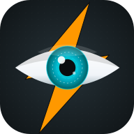
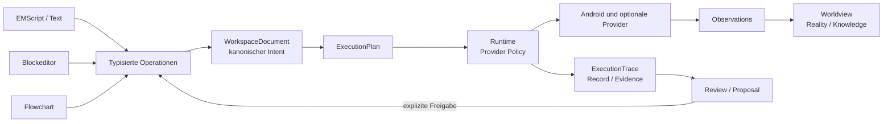

<p align="center">
  
</p>

<h1 align="center">VisualTasker Studio</h1>

<p align="center">
  <strong>Eine Automation. Drei Editoren. Ein kanonisches Modell.</strong><br />
  Android-native Workflows visuell entwerfen, als EMScript bearbeiten, nachvollziehbar ausführen
  und aus echten Interaktionen weiterentwickeln.
</p>

<p align="center">
  
  
  
  <a href="LICENSE"></a>
</p>

<p align="center">
  <a href="docs/ROADMAP.md">Roadmap</a> ·
  <a href="docs/FEATURE_STATUS_MATRIX.md">Feature-Matrix</a> ·
  <a href="VISUALTASKER_ARCHITECTURE_CONTRACT.md">Architekturvertrag</a> ·
  <a href="docs/testing/README.md">Tests</a>
</p>

> [!IMPORTANT]
> **Pre-Alpha / aktive Entwicklung.** Im Repository sind belastbare Kernpfade implementiert und
> getestet, aber VisualTasker Studio ist noch kein Stable-1.0-Produkt. Es gibt derzeit keinen
> Release-Tag. `versionName = "1.0"` ist Build-Metadatum und keine Release-Aussage.

## Was ist VisualTasker Studio?

VisualTasker Studio (VTS) ist eine Android-native Entwicklungsumgebung für visuelle Automation.
Ein Workflow lebt nicht getrennt in mehreren Editoren, sondern in einem gemeinsamen, typisierten
Dokument. EMScript-, Block- und Flow-Darstellung sind synchronisierte Projektionen derselben
fachlichen Wahrheit.

VTS verbindet damit mehrere Ebenen, die klassische Macro-Apps häufig getrennt behandeln:

- **Authoring:** Text, Blöcke und Flowgraph für denselben Workflow.
- **Runtime:** typisierte Ausführungspläne, explizite Providerwahl und nachvollziehbare Ergebnisse.
- **Recording:** reale Interaktionen werden als Record und Evidence erfasst – nicht sofort als
  vermeintlich richtiger Workflow übernommen.
- **Worldview:** Accessibility, OCR, Screenshots, Marker und spätere Vision-Provider liefern
  Beobachtungen über die reale Geräteumgebung.
- **Workspace:** frei anordnbare Panels für Editor, Recorder, Inspector, Runtime und Ressourcen.

## Warum VTS anders gedacht ist

| Prinzip | Bedeutung |
| --- | --- |
| **Eine Wahrheit, drei Editoren** | EMScript, Blockeditor und Flowchart mutieren dasselbe kanonische `WorkspaceDocument`. |
| **Semantik vor Oberfläche** | Stabile IDs, typisierte Operationen, Validierung und Transaktionen schützen den Workflow vor stiller Divergenz. |
| **Provider statt Sonderfälle** | Native Gesten, Accessibility, Tasker, Shizuku, Termux, Browser und spätere Remote-Systeme werden als Fähigkeiten mit expliziter Verfügbarkeit modelliert. |
| **Recording ist ein Vorschlag** | `Record → Interpretation → Proposal → Validierung/Freigabe → Workflow` verhindert, dass rohe Touch-Daten unbemerkt zur Wahrheit werden. |
| **Beobachtung ist nicht Absicht** | Workflow beschreibt Intent; Worldview beschreibt beobachtete Realität und Unsicherheit; die Runtime verbindet beides. |
| **Nachvollziehbare Ausführung** | ExecutionTrace, RailTrace, Records und Evidence sollen jede Providerentscheidung und jedes Ergebnis prüfbar machen. |

## Architektur



Die unverhandelbaren Regeln sind:

- **Workflow = Intent**
- **Worldview = Reality / Knowledge about Reality**
- **Runtime = koppelt Intent und Reality**
- Editoren und Panels sind Projektionen, keine unabhängigen Datenwelten.
- KI/RAG darf erklären und Änderungen vorschlagen, aber Workflow oder Worldview nicht still
  mutieren.

Der vollständige Vertrag steht im
[VisualTasker-Architekturvertrag](VISUALTASKER_ARCHITECTURE_CONTRACT.md).

## Inspirationen – und was VTS daraus macht

VisualTasker Studio ist kein Fork der folgenden Produkte und verwendet deren Namen nicht als
Kompatibilitätsversprechen. Es abstrahiert bewährte Ideen in eine eigene Android-/Compose-
Architektur.

| Referenz | Relevante Idee | Übersetzung in VTS |
| --- | --- | --- |
| [Blockly](https://docs.blockly.com/guides/get-started/what-is-blockly/) | Verständliche visuelle Grammatik, zusammensetzbare Blöcke und typisierte Anschlüsse | Eigener nativer Compose-Blockeditor als Projektion des kanonischen Workflow-Modells – keine Blockly-Web-Einbettung. |
| [Tasker](https://tasker.joaoapps.com/userguide/en/index.html) | Android-Automation, Context-/Task-Denken und ein starkes Plugin-Ökosystem | Tasker wird als optionaler Provider/Bridge eingeordnet; VTS ergänzt Graph, gemeinsame Editorsemantik und durchgängige Traces. |
| [Macrorify](https://play.google.com/store/apps/details?id=com.kok_emm.mobile) | Record & Replay, Multi-Touch, Bild-/Texterkennung und optionales EMScript | Recorder, Grounding Candidates, Evidence und EMScript werden getrennt modelliert und erst nach Review in Workflow-Intent überführt. |
| [Automate](https://llamalab.com/automate/doc/flow.html) | Ausführbare Flowcharts aus Blöcken und Pfaden, Bedingungen sowie parallele Laufinstanzen | VTS erweitert die Autorenseite um synchrones Text-/Block-/Flow-Editing, typisierte Operationen, Provider-Policy und Worldview-/Evidence-Kontext. |
| **Morf** | Reaktives Verhalten, lebendige Oberflächen und physikbewusste Overlays | Konzeptquelle für spätere kontextuelle/physikalische Overlay-Interaktionen; aktuell experimentell und nicht Teil des 1.0-Kernpfads. |

### Einordnung im Android-Ökosystem

[Automate](https://www.llamalab.com/automate/) ist der naheliegendste, aktuell gepflegte direkte
Vergleich: ein reifes Android-Produkt mit Flowcharts, persistierbaren Laufinstanzen und mehr als
400 Blöcken. VTS ist heute nicht breiter ausgeliefert. Sein weitergehender Anspruch liegt in der
Architektur: drei synchronisierte Editoren, ein kanonisches typisiertes Modell, kontrollierte
Recorder-Übernahme sowie die Trennung von Workflow, Runtime und Worldview.

[Pocket Code / Catrobat](https://developer.catrobat.org/) ist ebenfalls visuelle Programmierung
direkt auf Mobilgeräten, zielt aber primär auf kreative und lernorientierte Programme statt auf ein
Android-Automationsstudio. Unter den hier verglichenen, gepflegten Projekten gibt es damit keinen
direkten Gegenpart, der genau VTS' Kombination aus Text-, Block- und Flow-Editor, Android-Runtime,
Recorder-Evidence und Worldview verfolgt. Das ist eine Markt- und Architekturbeobachtung, kein
Anspruch auf globale Einzigartigkeit.

## Aktueller Entwicklungsstand

Die [Feature Status Matrix](docs/FEATURE_STATUS_MATRIX.md) führt **146** einzeln klassifizierte
Funktionen (Stand 2026-10-11, nach Abschluss von M5-8):

| Status | Anzahl | Aussage |
| --- | ---: | --- |
| `IMPLEMENTED` | 55 | Produktiver und nachgewiesener Pfad vorhanden |
| `PARTIAL` | 45 | Nutzbarer Teilpfad, aber noch offene Gates |
| `PLANNED` | 28 | Für den definierten Pfad geplant |
| `DEFERRED` | 12 | Bewusst auf später verschoben |
| `CONCEPT` | 5 | Architekturidee ohne Produktzusage |
| `BLOCKED` | 1 | Benötigt zuerst eine Scope-/Vertragsentscheidung |

### Bereits nachgewiesene Kernpfade

- Kanonisches Workflow-Dokument mit stabilen Entity-/Relation-IDs, validierten Transaktionen,
  Persistenz und serialisierbaren Projektionen.
- Zentrale Text-/Block-/Flow-Roundtrip-, Rollback-, History- und Conformance-Pfade.
- Deterministische Ausführungsplanung und Provider-Policy mit expliziter Availability-, Permission-
  und sicherer Fallback-Semantik.
- Native Android-Kernpfade für `wait`, Touch, Swipe, PointerPath und MultiPointer sowie ein
  begrenzter, auf einem realen Gerät geprüfter Accessibility-`clickText`-Pfad.
- Frei anordnbare Workspace-Panels mit Fokus/Z-Order, Drag/Resize und Session-Persistenz.
- Recorder-Persistenz, Step Candidates, Review-Modelle, RailTrace, Playback und Recovery als
  produktive Teilkette.
- Vorbereitete Integrationsverträge für ShapeMaker, ChartGraph, Vision, Tasker, Shizuku, Termux,
  Custom Tabs, VT2VT und ein separates IME.

`IMPLEMENTED` bedeutet dabei einen belegten Repository-Pfad – nicht automatisch vollständige UX-
Abnahme, Geräteabdeckung oder Stable-Reife. Details stehen in der
[Feature-Matrix](docs/FEATURE_STATUS_MATRIX.md) und in den
[bekannten Grenzen](docs/KNOWN_LIMITATIONS.md).

## Weg zu Stable 1.0

M5-8 (deterministische Provider-Policy) ist abgeschlossen. Der aktuelle kritische Pfad lautet:

```text
M5-H Headless Runtime
  → M6-W WindowSession
  → M7 Capture / Display Context
  → M7 Recorder-to-Workflow
  → M8 Projektportabilität
  → M10 Hardening
  → Alpha → Beta → RC → Stable
```

Die nächsten Release-Gates sind insbesondere:

1. ein prozessweiter Headless-/Foreground-Runtime-Host mit Stop, Recovery und UI-Reattachment,
2. ein gemeinsamer WindowSession-/Display-Vertrag für Shell und Overlay,
3. ein gemeinsamer CaptureFrame-/Display-Kontext für Accessibility, OCR, Marker und Evidence,
4. der geschlossene Pfad `Record → Review → Proposal → explizite Workflow-Freigabe`,
5. ein portables Projekt-/Ressourcenformat inklusive Backup und Restore,
6. Security-, Privacy-, Langlauf-, Device-Matrix- und reproduzierbare Release-Gates.

Siehe [Roadmap](docs/ROADMAP.md), [Release-Scope](docs/architecture/RELEASE_1_0_SCOPE.md) und
[Release-Plan](docs/architecture/RELEASE_1_0_PLAN.md).

## Repository-Struktur

| Pfad | Rolle |
| --- | --- |
| `app/` | Android-App, Workspace-Shell, Recorder, Runtime-Anbindung und Provider-Adapter |
| `visualtasker-blockeditor/` | Workflow-Core, EMScript, Semantik und Compose-Blockeditor |
| `visualtasker-flowchart/` | Flowchart-Domain, Layout, Routing, Validierung und Compose-Editor |
| `VisualTasker M3ShapeMaker Plugin/` | VisualAsset-/ShapeMaker-Integration |
| `VisualTasker ChartGraph Plugin/` | optionale ChartGraph-Komponenten |
| `VisualTasker Vision AI Plugin/` | Vision-Verträge und optionale Modellprovider |
| `VisualTasker Integrations Plugin/` | Integrationsverträge |
| `VisualTasker IME Keypad/` | separates IME-/Companion-Projekt |
| `docs/` | Architektur, ADRs, Status, Roadmap, Tests und Betriebswissen |

Der lokale Repository-Name enthält historisch den Zusatz **WSS** für *Workspace Shell*. Die
öffentliche Produktbezeichnung und eine mögliche Repository-Umbenennung sind noch nicht final
freigegeben.

## Bauen und testen

### Voraussetzungen

- JDK 17
- Android Studio mit Android SDK 36
- Git mit Submodule-Unterstützung
- Android-Gerät oder Emulator für Android-spezifische Abnahmen

### Checkout und Debug-Build

```bash
git clone --recurse-submodules https://github.com/robertprit/VisualTasker-Studio-WSS.git
cd VisualTasker-Studio-WSS
./gradlew :app:assembleDebug
```

### Kernregressionen

```bash
./gradlew \
  :visualtasker-blockeditor:blockeditor-registry:test \
  :visualtasker-blockeditor:blockeditor-compose:compileDebugKotlin \
  :app:testDebugUnitTest \
  :app:compileDebugKotlin \
  --console=plain
```

Diese Befehle prüfen Build und automatisierte Tests. Installation, Vordergrundstart, konkreter UI-
Zustand und reale Runtime-Aktionen sind getrennte Abnahmegates.

Manuelle Einstiege:

- [Teststrategie und Statuswerte](docs/testing/README.md)
- [Master Test Catalog](docs/testing/MASTER_TEST_CATALOG.md)
- [Core Smoke Test](docs/testing/00-CORE-SMOKE.md)
- [Smoke Test Matrix](docs/SMOKE_TEST_MATRIX.md)

## Berechtigungen, Datenschutz und Sicherheit

Einige Automationspfade benötigen Android Accessibility, Foreground Services, Screenshots oder
externe Apps. VTS soll fehlende Berechtigungen und nicht verfügbare Provider explizit
diagnostizieren; es darf nicht still auf einen anderen Provider oder ein anderes Display
ausweichen.

Recorder-, Screenshot- und Evidence-Daten können sensible Inhalte enthalten. Vor einem
öffentlichen Release fehlen noch die vollständige Privacy-/Log-Redaktionsprüfung und verbindliche
Geräte-/Langlaufabnahmen.

## Weiterführende Dokumentation

- [Architekturvertrag](VISUALTASKER_ARCHITECTURE_CONTRACT.md)
- [Worldview Architecture](docs/WORLDVIEW_ARCHITECTURE.md)
- [EMScript Truth Map](docs/emscript/EMSCRIPT_LANGUAGE_TRUTH_MAP.md)
- [Provider Policy M5-8](docs/architecture/M5_8_PROVIDER_POLICY.md)
- [Known Limitations](docs/KNOWN_LIMITATIONS.md)
- [Backup and Debug](docs/BACKUP_AND_DEBUG.md)

## Lizenz und Markennamen

Der WSS-Host steht unter der [Apache License 2.0](LICENSE). Abhängigkeiten, optionale Provider,
Modelldateien und eingebettete Projekte können zusätzlichen oder abweichenden Bedingungen
unterliegen; siehe [Third-Party Notices](THIRD_PARTY_NOTICES.md) und die Lizenzdateien der
jeweiligen Komponenten.

Blockly, Tasker, Macrorify und Automate sind Namen bzw. Marken ihrer jeweiligen Rechteinhaber.
VisualTasker Studio ist mit diesen Projekten nicht verbunden und wird von ihnen nicht unterstützt.
